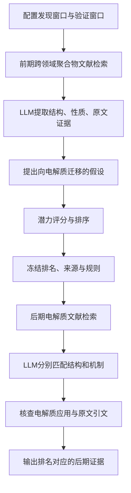

# Polymer Transfer Harness

从跨领域聚合物文献中发现电解质材料线索，并用后续时间窗中的电解质研究检验这些线索。

项目采用两个连续时间窗：先从前五年的聚合物研究中提取结构、性质和迁移假设，形成潜力排名；冻结排名后，再检索后五年的电解质文献，判断类似结构或机制是否得到应用。早期文献不必研究电解质，也不必报告离子输运或电导率。

当前主入口是 `temporal_harness/`。`spe_agentic_harness/` 和 `spark_agentic_harness/` 保留文献提取、工具调度、知识存储、计算接口以及已有复现实验。

## 方法流程



默认发现窗口为 **2015—2019年**，验证窗口为 **2020—2024年**。起始年份和窗口长度可配置。

早期排序使用四个维度，各0—3分，等权求和：配位潜力、链段运动、盐相容性、结构可实现性。缺少支持的维度计0。评分是LLM基于来源证据给出的**电解质迁移潜力**，不是以 S/cm 为单位的电导率预测。

后期匹配分别记录结构关系、机制关系及是否实际研究电解质。没有检索到支持时记录为 `not_found_in_retrieved_corpus`；不把它当作材料性能失败。引用匹配通过后的正例仍标记为待语义审核的证据。

## 快速开始

### 1. 环境

本项目当前在 Windows、Python 3.11 上开发和测试。新的时间分窗主流程只使用 Python 标准库，无需安装 PyTorch、DGL 或本地模拟引擎。

```powershell
python -m venv .venv
.\.venv\Scripts\Activate.ps1
Copy-Item .env.example .env
```

Linux/macOS 可使用 `source .venv/bin/activate` 和 `cp .env.example .env`。跨平台完整实验尚未验证。

### 2. 配置模型

在项目根目录 `.env` 中填写：

```dotenv
LLM_API_KEY=your-api-key
LLM_BASE_URL=https://api.deepseek.com
LLM_MODEL=your-available-model-name
```

模型服务需要兼容 `/chat/completions` 接口，并能够按提示返回JSON。实际可用模型名称以自己的服务账号为准。同名进程环境变量优先于 `.env`。`.env` 已排除在 Git 跟踪范围之外。

执行文献抽取和匹配时，会将所选文献文本发送给配置的模型服务。离线单元测试不调用外部模型。

### 3. 先运行离线测试

```powershell
python -m unittest discover -s temporal_harness -p test_temporal.py
```

这6项测试使用合成数据和模拟LLM，检查时间边界、冻结约束、引用校验、状态恢复及未知结果的语义。它们不代表真实文献实验性能。

### 4. 使用自己的文献目录

准备 `papers.json`，内容为数组。每条记录需要可靠的 `id`、整数出版年份 `year` 和非空 `text`；推荐同时提供 `title` 和 `doi`。例如，下列仅演示格式：

```json
[
  {
    "id": "source-paper-id",
    "year": 2017,
    "title": "Replace with the actual paper title",
    "doi": null,
    "text": "Replace with the actual abstract or extracted full text."
  }
]
```

将真实早期和后期文献放入同一数组即可，程序按年份分流；未来文献不会进入早期抽取提示。

```powershell
python run.py temporal --start 2015 --years 5 --out temporal_runs/run01 --catalog papers.json
```

只有前期文献时也能生成排名和空的后期支持记录。没有提取出候选时，程序不会生成空排名冒充结果。

### 5. 在线检索

```powershell
python run.py temporal --start 2015 --years 5 --out temporal_runs/online01 --discover "polymer separation membrane" --discover "self healing polymer" --validate "polymer electrolyte coordination" --validate "solid polymer electrolyte flexible chain" --pages 1
```

可重复提供 `--discover` 和 `--validate` 扩展检索主题。当前通过 OpenAlex 按出版日期范围分页，每个主题每页最多100条，`--pages` 为1—20；没有摘要的记录跳过。在线检索获得的是摘要，不是自动下载的全文。该新模块目前未接入 `.env` 中的 `OPENALEX_API_KEY`，该配置供旧版检索模块使用。

检索是有界主题搜索，不能视为穷尽领域文献。当前后期匹配逐一比较候选与论文，模型调用量随二者乘积增长；建议先用小型本地目录检查抽取质量，再扩大规模。

## 代码结构

```text
.
├── README.md
├── .env.example                     # 共享配置示例，不含密钥
├── .gitignore                       # 源码仓库排除规则
├── run.py                           # 统一命令入口
├── requirements.txt                 # 历史实验的主要依赖
├── temporal_harness/                # 当前研究主流程
│   ├── harness.py                   # 工具定义、分窗、提取、排序冻结、后期验证
│   ├── run.py                       # CLI阶段调度
│   ├── test_temporal.py             # 不调用网络的流程测试
│   └── 使用说明.txt
├── spe_agentic_harness/             # 基础研究工具
│   ├── harness.py                   # ResearchHarness及execute接口
│   ├── planner.py                   # 既有LLM总控
│   ├── config.py                    # 根目录.env读取
│   ├── llm.py                       # 模型请求与JSON解析
│   ├── online.py                    # 旧版检索与PDF下载/批处理
│   └── ...                         # 知识存储、性质计算与测试
├── spark_agentic_harness/           # SPARK适配与历史实验
│   ├── spark_harness.py             # SparkHarness工具扩展
│   ├── transport_extraction.py      # 电解质数值证据提取
│   ├── conductivity_completion.py   # 已有数据查找、计算与轨迹后处理
│   └── external_conductivity/
│       ├── hpg_graph_adapter.py     # HPG输入、图构建与预训练推理适配
│       ├── test_public_hpg.py       # 作者公开验证集复现脚本
│       └── literature_graph_experiment/ # 文献配方构图与敏感性实验
└── verify_bundle.py                 # 本地完整资料包检查，非源码仓库测试
```

本地目录中的论文库、原SPARK分享包、报告、模型仓库和运行时不是源码仓库的必需内容，默认不上传。

## 工具定义与总控

`temporal_harness/harness.py` 的 `definitions()` 返回函数调用格式的工具定义；`TemporalHarness.execute(name, arguments)` 是统一执行接口。

| 工具 | 功能 |
| --- | --- |
| `search_window` | 在指定时间窗内检索并保存检索批次 |
| `extract_source` | 提取早期候选、原文引文与迁移潜力评分 |
| `freeze_ranking` | 固化排名、评分规则、来源哈希 |
| `validate_later` | 比较后期电解质应用中的结构与机制 |
| `report` | 输出冻结排名及其后期支持证据 |

当前新CLI采用代码控制的阶段顺序，LLM负责提取、迁移评估和匹配；它尚未由旧 `planner.py` 自动调度。已有工具定义可以用于后续接入总控LLM。阶段门禁由代码执行，不能靠模型自行遵守时间边界。

```powershell
python run.py temporal --out temporal_runs/tool_schema --tools
```

上面的命令仅输出工具定义，不运行研究任务。

## 记忆与结果

| 文件 | 内容 |
| --- | --- |
| `state.json` | 早期来源、候选、冻结排名及后期匹配；支持恢复 |
| `frozen_ranking.json` | 仅由早期证据生成的排名与哈希 |
| `search_*.json` | 查询、时间窗与检索到的摘要 |
| `events.jsonl` | 成功执行的工具调用、输入哈希和结果 |
| `report.json` | 每个排名候选对应的后期证据 |

同一输出目录必须使用相同时间窗。冻结后可继续补充后期验证；若要扩展早期来源或修改评分规则，应使用新的输出目录。当前候选以“论文中的一条结构/机制线索”为单位，尚未实现跨论文的材料家族合并。

## 历史实验与可选依赖

根目录 `requirements.txt` 面向既有提取、数值分析和模型实验；不需要为时间分窗主流程安装整套依赖。

```powershell
pip install -r requirements.txt
```

完整HPG实验还依赖 RDKit、DGL、torch-geometric、作者模型代码与权重；OpenMM/xTB需要对应平台的运行时。当前工作站的 `.deps` 和 `.runtime` 不会上传，`requirements.txt` 不能单独重建所有可选环境。

| 入口 | 用途 | 额外条件 |
| --- | --- | --- |
| `python run.py temporal ...` | 当前时间分窗研究 | 真实运行需模型API；在线检索需网络 |
| `python run.py test` | 两套旧Harness测试 | 主要依赖；不包含新分窗测试 |
| `python run.py plan --task "研究问题"` | 旧版LLM总控 | 模型API；部分工具需本地资料 |
| `python run.py smoke` | SPARK归档工具检查 | 原分享包 |
| `python run.py case` / `batch10` | 既有文献案例实验 | 本地论文与数据、模型API |
| `python run.py completion` | 既有性质补全样例 | 对应归档与输入数据 |
| `python run.py hpg` / `scan` / `baseline` | 公开模型及指纹基线实验 | 对应第三方代码、权重和数据 |

本地已完成三篇PEO对照文献的抽取—构图—HPG推理实验：17项图与输入检查通过，24次本地图查询及12次LLM抽取后的复跑完成。它们包含重复和敏感性查询，不是36个独立样本。其中ACS Nano对照的HPG预测比实测高约9.9倍。因此HPG目前不直接进入新主流程的评分。详细方法见 `spark_agentic_harness/external_conductivity/literature_graph_experiment/实验说明.txt`；原始结果默认留在本地。

## 研究解释

本项目进行时间分窗的回溯验证。现代LLM可能在预训练中见过后期研究，因此输入隔离与冻结排名不等于历史盲预测。结构或机制在后期出现，也不能单独证明作者受到早期论文启发。

当前版本已通过6项新流程单元测试，尚未完成大规模分窗文献实验。原文引用检查验证出处，结构与机制匹配仍需要研究人员审核。排序分数、实测电导率与模型预测应分别报告。

## 上传 GitHub

建议将本目录作为仓库根目录，例如命名为 `polymer-transfer-harness`。`.gitignore` 已排除 `.env`、论文库、模型权重、运行时、历史输出和报告；它不会删除本地文件。

在本目录执行：

```powershell
git init
git add .
git status --short
git diff --cached --stat
```

检查暂存文件后创建首次提交：

```powershell
git commit -m "Add temporal polymer transfer harness"
git branch -M main
```

在GitHub创建一个空仓库，再将下面地址替换为实际地址：

```powershell
git remote add origin https://github.com/YOUR_ACCOUNT/polymer-transfer-harness.git
git push -u origin main
```

仓库目前没有选定开源许可证。公开源码与授予开源使用权限是不同事项；发布前由项目所有者决定许可证，并保留第三方代码的归属说明。原始论文、合作方资料和下载的模型不随源码自动再分发。
