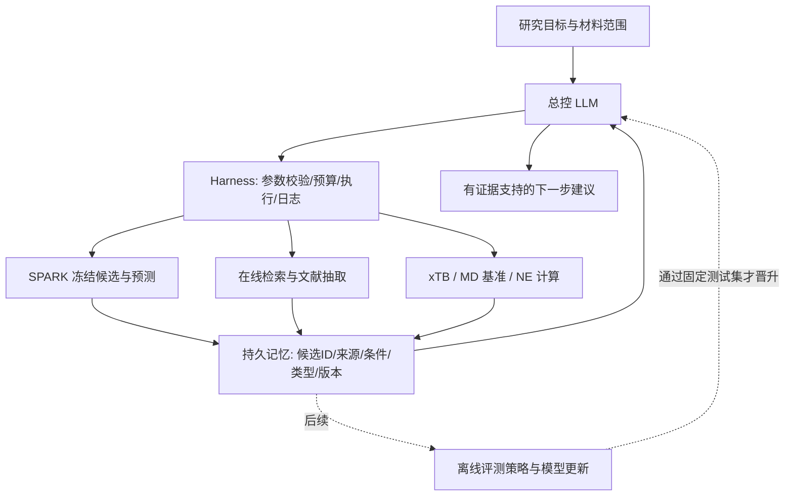

# SPARK Agentic Harness

本目录在 SPARK 共享包外增加 LLM 工具调度层，复用 ../spe_agentic_harness 的文献、计算与记忆能力。原包保持只读；新代码、日志和数据库均在本目录。它依赖旁边的两个项目，不是独立分发包。

## 电导率补全与原物性模型（2026-11-17）

原R4.2物性模型由作者自行训练：1,010条OU、373个文献组；连续值为Ridge、ExtraTrees、HistGradientBoosting三个回归器预测log10(σ/S·cm⁻¹)的中位数；阈值分支从Logistic、ExtraTrees、HistGradientBoosting分类器中选择，再校准概率。20260814归档最终选择HistGradientBoosting分类器。文献分组验证避免同论文跨折，分类采用5外层/4内层嵌套验证。原始物性是粗粒度组件与温度模型，没有完整配方比例和加工参数。三个展示种子的平均MAE为0.9762 log10单位，适合粗筛，不是精确配方的电导率保证。

`01_code/spark_world_model/hc_cwm_v4_r42/property_decoder.py`保留训练与推理源码，分享包保留258候选×3种子的预测。当前本地未发现完整1,010 OU及训练好的物性模型；另在旧项目找到3,469行CSV。旧表不能直接当作1,010 OU或原模型权重。

新增工具直接注册在`SparkHarness.definitions()`，总控通过`execute(name, arguments)`调用，结果写入SQLite并可用`get_simulation_record(record_id)`回读：

|工具|输入|输出与用途|
|---|---|---|
|`search_legacy_conductivity`|题名/聚合物/盐关键词，limit|旧表原字段、行号、文件SHA；需核对样品与原文|
|`lookup_spark_conductivity`|从`spark_candidates`取得的精确candidate_id|三个种子的25℃归档预测、阈值概率、适用度、弃权原因；不执行新推理|
|`conductivity_from_resistance`|同一样品的膜厚µm、面积cm²、体相电阻Ω、温度K、来源|σ=L/(R·A)，S/cm；不拟合阻抗谱，不接受电荷转移电阻|
|`conductivity_from_trajectory`|NPZ轨迹路径、温度、拟合窗口、样品和来源|集体Einstein–Helfand电导率、NE电导率及比值、拟合诊断；不启动MD|

轨迹NPZ必须含`positions_nm[frames,carriers,3]`、`time_ps[frames]`、`charge_numbers[carriers]`、标量`volume_nm3`。坐标是解包后的电荷载体质心，恒定体积；包括固定带电聚合物基团，所有载体净电荷总和为零。不能把原子部分电荷的自扩散当成离子自扩散。现有轨迹分析只返回初步值，不自动认可收敛、不进入正式材料排名。

补全顺序：先查同篇旧表和全文/SI；有阻抗几何参数则派生电导率；有其他温度σ及传导Ea则用已有局部Arrhenius工具；有扩散系数和浓度则用已有`predict_conductivity(method='nernst_einstein')`；有完整MD轨迹则用新增集体分析。只有结构而没有上述数据时，需要配方、力场和充分采样的MD，或经过适用域验证的ML模型。LLM负责选择工具和补证据，不填造σ、D或Ea。

```powershell
python spark_agentic_harness/run_completion_demo.py
python spark_agentic_harness/run_completion_planner.py
python -m unittest discover -s spark_agentic_harness -p "test_*.py"
```

第一条不调用LLM：检索真实旧表/模型归档，使用合成几何参数测试EIS单位，再分析此前真实LiCl水溶液100 ps轨迹。第二条使用共享.env的模型，最多10次调用，自主查询旧表、预测归档和记忆。

首次测试`outputs/conductivity_completion_20261117_155203`：PMHS/咪唑鎓/TFSI的三个归档预测为2.7131e-4、2.4334e-4、3.7425e-4 S/cm；ZIF-67@CF/PEO-SN旧表匹配两行，但σ字段均为空，不能补全。LiCl轨迹10–40 ps拟合得到集体σ=0.08629、NE=0.11326 S/cm；20–50 ps改为0.06641和0.09922 S/cm。窗口敏感性明显，结果只检验轨迹后处理接口，既非收敛验证，也非聚合物预测。本轮没有重跑MD。

可进一步部署的外部引擎：PEMD提供聚合物构建、GROMACS模拟及输运分析（https://github.com/HouGroup/PEMD）；MDAnalysis提供EinsteinMSD（https://docs.mdanalysis.org/dev/documentation_pages/analysis/msd.html）；SEAMM有集体/NE电导率分析（https://molssi-seamm.github.io/ionic_conductivity_step/user_guide/index.html）。这些第三方程序尚未部署为本项目远程服务，当前remote_ml/remote_md接口没有连接可用预测提供方。xTB配位能不等于电导率，RadonPy热导率也不等于离子电导率。

## 十篇自主规划样例（2026-11-17）

`outputs/batch10_20261117` 保存10篇不同论文的完整真实运行。总控自主选择读取、独立分类、性质评估及记忆查询工具，10例均返回中文建议。累计64次模型调用、184,110个服务端报告token，含4次格式错误后的恢复。

性质结果：5篇在局部温区做Arrhenius外推，1篇保留目标温度25℃原文实测，4篇因温度不明、VTF参数、解离能或填料/复合物参数混用而返回needs_input。性质参数由助手从摘要转录并核对，拒绝规则由工具执行。这组样例用于验证工具调度与建议链路，不是自动性质抽取或新结构预测的准确率评测。C05的SPE分类边界、C01的SIPE/D-SIPE样品归属需全文复核。

```powershell
python spark_agentic_harness/prepare_batch10.py
python spark_agentic_harness/run_batch10.py
python spark_agentic_harness/summarize_batch10.py
python -m unittest discover -s spark_agentic_harness -p "test_*.py"
```

运行器缓存已有结果，不会重复扣费。每例独立SQLite记忆位于C01…C10目录。`summary.json`供程序读取，`全部样例与总结.txt`供阅读；每例有`planner_trace.jsonl`、`events.jsonl`、`recommendation.txt`。输入冻结在`catalog.json`、`cases.json`和`manifest.json`。新工具接口为`assess_temperature_property(paper_id, temperature_K)`，定义在`run_batch10.py`，通过子类接入现有SparkHarness。

中文总结PPT位于`outputs/discussion_delivery`，按用户提供的11-16 Discussion模板生成，共13页。构建源码与校验记录位于`outputs/discussion_build`。

## 自主调度与推荐样例

`python spark_agentic_harness/run_recommendation_demo.py` 使用已配置的模型运行单篇文献演示。总控通过工具定义选择动作；不是脚本预先指定调用顺序。仅开放此任务相关工具，模型最多调用14次、执行11步。

新增工具 `project_paper_conductivity(temperature_K)` 使用助手从指定PEO–NaClO4/NZSP论文摘要转录、并逐字核对出处的实测电导率与活化能，进行有限温区Arrhenius外推。它不是自动通用性质抽取器、新结构预测模型或MD后端。输出保存到SQLite，附原文、DOI、假设、单位和来源类型；不会自动晋升为正式排名证据。

实跑结果在 `outputs/recommendation_20261117_130804`：总控5次调用、3次成功工具执行，完成读取→外推→记忆查询→文字推荐；其中一次动作格式无效后继续完成。模型没有选择调用独立应用分类工具。25℃估计值分别为3.3003e-5和2.5434e-5 S/cm，推荐以25 wt%为电导率优先验证对象，150 wt%作为迁移数对照。这是钠体系的方法演示，不构成锂电解质新材料发现。

查看 `recommendation.txt` 获取模型原始建议，`planner_trace.jsonl` 查看每一步选择与观察，`events.jsonl` 查看工具执行和记忆记录。当前7项单元测试覆盖原工具行为及外推的参考温度、降温方向、证据缺失和越界拒绝。

## 原方案完成什么

依据原包 README、06_reports 阶段汇报及 R4.2 planner/property_decoder 源码：

- 将跨领域文献归一成骨架、阳离子、阴离子和局部关系，区分 SPE、非 SPE 与待确认应用。
- 以 2004、2009、2014、2019、2024 为知识截止时间，先冻结预测，再揭晓下一时间窗事件，通过关系表示、自监督和持续学习预测应用迁移。
- 12×6×5 个粗粒度母题组成 360 项空间；2024 年扣除已有可信 SPE 核心，剩余 258 项。
- 静态解码器估计 25℃ 下的 log10 电导率、达到 1e-4 S/cm 的概率、适用域和不确定性。它包含 Ridge、ExtraTrees、HistGradientBoosting 等模型，不是 LLM 的直接判断。
- R4.2 用有界物性修正乘以 R4.1 发现分数。迁移、应用空白、兼容性、不确定性共同形成实验优先级；物性不可靠时可以弃权。
- 已选三个种子的目标母题排名为 10/258、10/258、8/258，共识为 8/258。三次运行是在观察结果后选择的展示子集，不能代表所有随机初始化的无偏稳定性。

包里包含源码、配置、审计指纹、脱敏 schema 示例及冻结结果；没有全量训练数据、原始证据、.pt/.joblib 模型权重。因此本次验证的是历史结果读取与 harness 接入，不是重新训练或新材料推理。

## 如何修改

保留科学模型，将其作为可调用专家工具；新增总控 LLM 决定获取什么证据、执行什么计算、何时停止。原代码中的 planner 是确定性排序器，与外层 LLM planner 分工不同。



当前实现：

| 工具 | 功能 |
|---|---|
| spark_capabilities | 明示缺失权重、新推理不可用、RSI 未实现 |
| spark_candidates | 查询指定种子的完整面板归档；保留原排名、弃权、条件与不确定性 |
| spark_summary | 读取已选三种子摘要，保留选择口径 |
| spark_screen_search | 按本次搜索得到的 ID 读取原始元数据并筛选，显式综述/观点文章作为背景 |
| read_application_paper | 从配置的本地目录表按ID读取题名摘要，隐藏银标和基线预测 |
| classify_application | 调用LLM判断SPE应用与独立迁移路线，校验精确引文，共享模型预算，输出保存至记忆 |
| 原 harness 工具 | 文献搜索、抽取、知识查询、已实现的计算接口 |

新工具输出自动存入独立 memory.sqlite 的 simulation_records，记录来源路径及 SHA256，可通过 get_simulation_record 查询；文献抽取仍进入文献知识表。总控复用统一模型/工具预算。配置继续读取之前 harness 的 .env，无需复制 API Key。

下一阶段接口设计（尚未实现）：

1. predict_migration(snapshot_id,candidate_ids,model_version)：接入恢复后的时间模型权重；返回概率与不确定性。
2. predict_static_property(candidate,conditions,model_version)：接入训练好的解码器；返回条件级预测和弃权理由。
3. resolve_recipe(candidate_id,evidence_ids)：把粗粒度母题细化成结构、聚合度、端基、盐浓度、添加剂；缺失项进入 needs_input。
4. rank_recommendations(snapshot_id,policy_version)：保持原完整面板基线，同时生成独立的新版本建议；新文献、实测和模拟不能直接覆盖历史预测。
5. propose_policy_update → evaluate_policy → promote_policy：RSI 先优化检索/工具选择/预算策略，再考虑模型再训练；版本记录包含父版本、变化、评测集、指标与晋升判据。持续摄入文献本身不等于 RSI。

推荐阶段同时报告科学潜力、证据强度、计算适用性与下一项实验。无电导率文献可进入候选池；没有配方和力场时不自动发起聚合物 MD。现有 LiCl 水溶液 benchmark 仅验证计算链路，不能替代候选聚合物电解质预测。

## 运行

从工作区根目录执行，不调用 LLM 的离线验证：

```powershell
python spark_agentic_harness/run.py
python -m unittest discover -s spark_agentic_harness -p "test_*.py"
```

实际 LLM 调度（使用既有 .env，会产生模型调用费用）：

```powershell
python spark_agentic_harness/run.py --task "查看 SPARK 能力，查询 polymethylhydrosiloxane 候选，解释已有预测、弃权原因以及还需补充哪些证据"
```

离线测试不会调用 LLM。每次运行建立独立 outputs 子目录；跨运行共用本项目 memory.sqlite。当前推荐为 LLM 根据工具结果形成的文字建议，尚未实现自动重新训练、正式重新排名或 RSI 晋升。

2026-11-17 初步实验：`run_pilot.py` 复核全量历史排序，`--live` 增加两项预算受限的 LLM 测试；`run_pilot_followup.py` 测试按 ID 筛选和一次全文抽取。结果见 outputs 下 pilot_20261117_105530 和 followup_20261117_105838。预算受限的抽取可以带问题结束；必须检查嵌套 result.status 和 issues，不能仅凭工具 status=ok 判断科学验收通过。

复核与固定评测：`build_review_benchmark.py` 保存7条助手复核记录、5篇论文的页级输入和11条参考记录；`evaluate_review_benchmark.py` 执行真实API抽取与弃权测试。参考答案不传入API，但指定样品和证据页已提供，不能当成全文召回率。`retest_abstention.py` 保留原4096预算失败数据，做8192预算对照；`summarize_review.py` 汇总本次固定运行。结果位于 outputs/review_20261117。标注由助手检查文本及页面建立，尚非独立专家金标准；目前行为测试有空输出，不能将自主推荐稳定性判为通过。

## 文献应用判断对照实验

`application_benchmark.py` 读取原WoS workbook和DeepSeek银标，先核对原审计SHA256，再按规范化题名分组。只用≤2019年训练、2020–2022年选择分类阈值，2023–2025年做测试。原分类器源码未包含在共享包内，因此这是HashingVectorizer＋类别平衡LogisticRegression的同类重建，不是逐参数复现。保留冲突组隔离记录。

```powershell
python spark_agentic_harness/application_benchmark.py
python spark_agentic_harness/application_benchmark.py --resume spark_agentic_harness/outputs/application_20261117_125231 --live
```

第二条命令只评估已冻结的32篇分层小样本，每类16篇，共4批。模型仅收到ID、题名和摘要，不接触银标、基线输出或参考答案。缓存已有批次；原始分数保留。`recover_application.py RUN_DIR` 最多追加4次小批恢复，仅处理完全无输出的记录，独立保存成本和恢复后分数。

不确定标签或引用错误进入待复核，不强制给二元标签；非SPE材料仍可标记structure_lead/transport_lead，所有结果eligible_for_ranking=false。候选迁移路线尚未经过专家评测，不可将银标一致率当作其准确率。

工具调用实测：

```powershell
python spark_agentic_harness/run_application_tools.py --catalog spark_agentic_harness/outputs/application_20261117_125231/pilot_frozen.json
```

该脚本实际执行read_application_paper→classify_application→get_simulation_record。若需LLM总控选择工具，可给`run.py --task ... --application-catalog ...`配置同一个目录表，并在任务中指定已知paper ID。模型的决定需经过引用、枚举、身份和预算检查，最终的材料适用性仍需全文证据。
