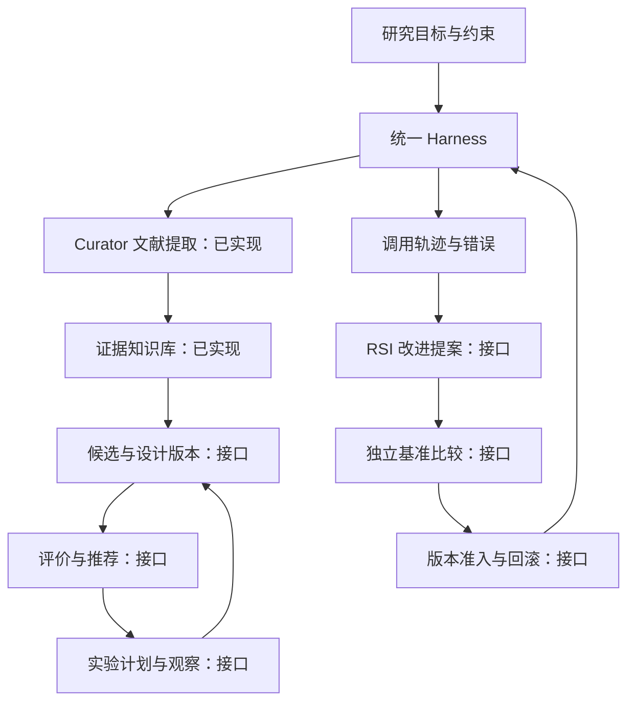

# SPE 研究 Harness：知识、研究状态与 RSI

## 范围与实现状态

本阶段实现文献文本抽取、证据校验、SQLite 持久化及知识查询。设计、推荐、实验和 RSI 在 `contracts.py` 中定义 Protocol 接口，不注册为可执行工具，也不产生模拟科研结果。上层自主 Planner 待接入。



## 文献知识如何保存

`knowledge.py` 使用 SQLite，保持两个层次：

| 表 | 保存内容 |
|---|---|
| snapshots | 项目 ID、完整抽取结果、来源 SHA256、原文引用、归一化值、问题、模型和策略出处 |
| assertions | 每个记录中各字段的值和证据、所属快照与记录序号、审阅状态 |

每次抽取形成不可变快照。完全相同的项目、结果和出处重复导入时幂等；不同抽取或修订产生新快照，旧值不会被覆盖。快照内的 `record_index` 维持样品与条件的分组关系；不会依据聚合物名称跨论文合并记录。

字段引用的 `S1` 等来源 ID 仅在该快照内解释。文件 SHA256 标识源文件内容，URL、DOI、页码和原文保存在原始结果内。原始值与归一化值同时保留。`issues` 随快照保存，存在问题的抽取仍可审计。

所有入库字段初始状态为 `unreviewed_extraction`。引用匹配只证明字串存在，不证明值正确或样品配对正确。冲突记录并存，不自动投票，也不自动升级为事实。当前查询为字段 JSON 的文本检索，暂不实现化学实体消歧、向量检索或图谱可视化。

已有 Curator 提取 sample、polymer、salt、salt_ratio、solvent、temperature、conductivity。后续扩展添加剂、结构、制备条件和作者机制解释时，应分别保留类型、证据和适用条件。机制假设、预测值及实测值不能使用同一个事实状态。

## 跨任务共享

```python
from harness import ResearchHarness

h = ResearchHarness(
    'outputs/run_new',
    client=client,
    knowledge_db='outputs/shared/knowledge.sqlite',
    project_id='spe-discovery',
    policy_version='curator-v1',
)
# extract_records 成功后自动入库，返回 snapshot_id。
# 新的运行目录可再次连接同一个 knowledge_db 和 project_id。
hits = h.execute('query_knowledge', {'text': 'PEO', 'limit': 20})
```

`get_knowledge_snapshot(snapshot_id)` 回溯整个结果及证据。默认不传 `knowledge_db` 时，数据库保存在本次运行目录。项目参数提供逻辑隔离，不是多用户权限系统。当前自动入库接在 harness 的 `extract_records` 上；直接运行 `curator.py` 或 `online.py` 仍生成 JSON，不自动写入共享库。

## 研究状态接口：为后续设计与推荐预留

| 对象 | 未来必备标识与关系 |
|---|---|
| Project | 目标版本、约束、预算、当前策略版本 |
| Candidate | 候选 ID、证据快照 ID、机制假设与开放问题 |
| DesignVersion | 父版本、结构、配方、工艺、变更理由 |
| Evaluation | 设计版本、计算/预测/实测类型、条件、误差、工具版本 |
| Recommendation | 候选集合、目标版本、排序依据、数据截点 |
| Experiment | 设计版本、假设、方案、观察与原始数据 |

这些对象通过 `DesignPort`、`RecommendationPort`、`ExperimentPort` 连接 harness，当前仅定义接口。所有评价绑定设计版本；实验失败限定到对应配方和条件，不能直接否定整个材料类别。

## RSI：改变策略，并用独立证据检验改进

积累知识属于记忆更新；修改检索策略、提示词、工具调度或模型参数，才是策略改进候选。RSI 预留四个接口：

1. `propose_revision`：基于失败事件和训练数据快照，提出相对父策略的变更。
2. `evaluate_revision`：冻结候选和基线，在同一版本基准、相同预算下比较。
3. `activate_revision`：按照预先定义的准入规则选择是否启用候选。
4. `rollback`：恢复指定旧策略并保存原因。

未来每个策略版本应记录提示词、模型版本、工具代码/配置摘要、数据谱系与父版本；每个评测记录测试集哈希、划分、重复次数、结果、调用成本和接受规则。训练/失败诊断集与封存测试集隔离，测试答案不能作为下一轮改进训练输入。

建议准入同时检查样品条件配对、引用支持、虚构值和预算。候选未通过时保留旧策略。所有变化以版本化数据或配置补丁表达，不让模型直接修改正在运行的工具或准入规则。框架版本改动需要独立验证；模型自评不能作为唯一准入证据。

当前不执行自训练、策略切换或回滚。真实实验反馈、独立评测器和上层 Planner 接入后，才能验证 RSI 是否带来持续提升。
