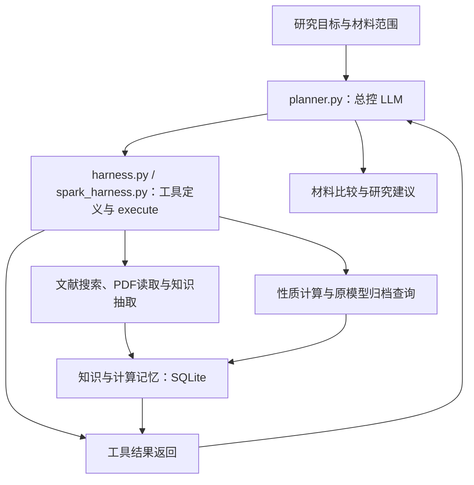
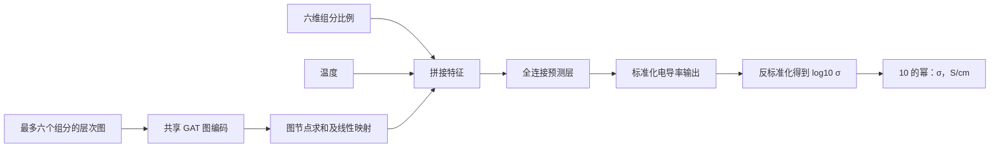

# 电解质研究 Harness：代码结构与 HPG 模型

本文对应独立项目 `Electrolyte_Harness_20261117`。整个项目把文献中的样品、配方和测试条件组织成结构化证据，通过性质工具进行计算，再利用研究记忆支持材料比较与推荐。

**HPG 模型本体是 `HPG/src/hpggat.py` 中的 `GATNet` 类；我们实际运行它的入口是 `test_public_hpg.py`。**

## 1. 项目文件结构

```text
Electrolyte_Harness_20261117/
├── .env                              # 整个项目统一的 LLM/API 配置
├── .env.example                      # 配置格式示例
├── run.py                            # 统一运行入口
├── requirements.txt                  # Python 基础依赖
├── README.txt                        # 快速运行说明
├── verify_bundle.py                  # 项目文件、数据与运行结果检查
│
├── spe_agentic_harness/               # 通用研究 Harness
│   ├── planner.py                    # 总控 LLM 的规划循环
│   ├── harness.py                    # 工具定义、参数检查、execute() 执行
│   ├── config.py                     # 从项目根部 .env 读取配置
│   ├── llm.py                        # 总控等任务使用的 LLM 客户端
│   ├── online.py                     # 在线文献搜索与获取
│   ├── curator.py                    # PDF 文本处理与文献知识抽取
│   ├── scope.py / scope.json          # 电解质研究范围与跨领域筛选
│   ├── contracts.py                  # 结构化记录约定
│   ├── knowledge.py                  # 文献与研究知识存储
│   ├── simulation.py                 # 性质/模拟工具接口与计算记录
│   ├── conductivity.py               # 电导率计算
│   ├── diffusion.py                  # 扩散计算接口
│   ├── openmm_worker.py              # OpenMM 计算子进程
│   ├── xtb_backend.py                # xTB 后端
│   ├── .runtime/                     # 已安装的 Windows 计算引擎运行时
│   ├── examples/                     # 工具输入示例
│   ├── test_*.py                     # 通用模块测试
│   └── outputs/                      # 历史运行结果和研究记忆
│
├── spark_agentic_harness/             # SPARK 任务适配与实验
│   ├── spark_harness.py              # 在通用 Harness 上增加 SPARK 工具
│   ├── application_benchmark.py       # 原数据、时间划分与分类基线重建
│   ├── application_classifier.py      # 文献应用分类及结果检查
│   ├── transport_extraction.py        # 电导率、温度和活化能等信息抽取
│   ├── conductivity_completion.py     # 旧数据检索、归档预测、阻抗/轨迹计算
│   ├── run_batch10.py                # 十篇样例的规划、性质评估与推荐
│   ├── run_case_study.py              # 全文案例的检索、抽取和计算
│   ├── run_policy_trial.py            # RSI 范围策略的开发集对比实验
│   ├── outputs/                      # 文献目录、逐例轨迹、SQLite 和实验汇总
│   └── external_conductivity/         # 外部电导率模型与新增实验
│       ├── test_public_hpg.py         # 我们的 HPG 权重加载、预测与评测入口
│       ├── test_public_scan.py        # SCAN 液态配方模型测试
│       ├── test_structure_baseline.py # 我们训练的结构指纹 + ExtraTrees 基线
│       ├── .deps/                    # RDKit、DGL 等本地附加依赖
│       ├── HPG/                      # 作者公开 HPG 项目
│       │   ├── src/
│       │   │   ├── hpggat.py          # 核心神经网络：GAT、GATNet
│       │   │   ├── mol2graph.py       # 分子/聚合物结构转换为 DGL 图
│       │   │   ├── polyG.py           # Fragment、Node、PolymerGraph 定义
│       │   │   └── smiles_utils.py    # 原子与 SMILES 特征处理
│       │   ├── ckpt/HPG_GAT.bin       # 作者训练好的模型权重
│       │   ├── data/polyG.pt          # 165 个聚合物结构图对象的缓存
│       │   ├── data/processed_electrolytes.csv
│       │   ├── HPG_GAT.ipynb          # 作者的模型训练/评测 notebook
│       │   ├── preprocessing.ipynb    # 作者的数据预处理 notebook
│       │   └── LICENSE
│       ├── SCAN/                     # 液态电解质模型代码与权重
│       ├── Chem-prop-pred/            # ChemArr 相关代码和公开数据
│       └── results/                  # HPG、SCAN、指纹基线的逐条预测和汇总
│
├── SPARK_selected3_seed_shareable_20260807/
│                                     # 原 SPARK 分享包的独立副本
├── To-ljh/                           # 当前实验使用的原始文献、标签和旧数据表
├── reports/                          # 汇报材料
│   ├── 整体Harness流程图.png
│   ├── delivery/                     # 最终合并 PPT
│   └── build/                        # PPT 构建脚本、渲染与验证记录
└── verification/                     # 独立项目校验结果
```

目录中的原作者模型与我们的实验脚本分别保存。SPARK 原模型、HPG 公开模型和我们训练的指纹基线是三套不同的模型。

## 2. 整个 Harness 怎样执行任务



总控通过工具定义了解可用能力，输出工具名称和参数。`execute()` 负责实际运行、预算管理和记录，结果返回总控用于下一步规划。研究记忆保存样品、原文证据、输入参数与计算结果，后续设计和推荐可以继续引用这些记录。

目前 HPG 和 SCAN 已完成**独立脚本推理测试**。根部 `run.py hpg` 能运行 HPG；它还没有作为具名工具注册到 `SparkHarness.definitions()` 中。整体图中的结构预测模型区对应这项已完成的能力，后续可接入同一个工具调用流程。

## 3. HPG 是什么，为什么适合我们的任务

HPG 是 **Hierarchical Polymer Graph（层次聚合物图）**。我们使用的公开模型称为 **HPG-GAT**：用层次图表示聚合物结构，再通过图注意力网络预测电解质的离子电导率。

它对应论文 *Deep learning prediction of ionic conductivity in polymer electrolytes using hierarchical polymer graphs*。代码来自[作者 HPG 仓库](https://github.com/spark8ku/HPG)，论文见[出版社页面](https://www.sciencedirect.com/science/article/pii/S1385894725076673)。作者 README 将原始数据来源指向 [ion_predictor](https://github.com/KanHatakeyama/ion_predictor)。

HPG 为我们提供的能力是：**将明确的聚合物结构、盐及配方比例和温度转化为数值电导率预测。** 这使文献中没有直接报告目标温度电导率的材料，也有机会进入计算筛选。

本项目使用作者已经训练好的 `HPG_GAT.bin`，在本机 CPU 上加载推理。我们增加了权重加载、兼容运行、逐条预测、温度响应查询及结果汇总脚本，没有重新训练 HPG。HPG 本身是 PyTorch 图神经网络，运行时不需要调用 LLM 或 API key。

### 3.1 模型输入

| 输入 | 在当前代码中的表示 | 需要从文献或结构处理中得到什么 |
|---|---|---|
| 聚合物结构 | `PolymerGraph` 转换成层次图 | 结构片段、连接关系及图编码需要的聚合信息 |
| 盐、溶剂等小分子组分 | SMILES 转换成分子图 | 对应组分的明确化学结构 |
| 配方比例 | 六维 `ratio` 向量 | 各组分比例，以及质量比/摩尔比和换算基准 |
| 温度 | 单个温度数值 | 预测或测试温度，数据入口采用 ℃ |

作者模型设置了**最多六个组分槽位**。公开数据中的聚合物用 `polymer_<id>` 引用结构缓存；小分子则使用 SMILES。缺少的组分槽位按作者流程填充，并在比例向量中补零。

现有 `predict_frame()` 复用作者带标签的数据读取流程，因此表格还包含 `Conductivity` 等评测列；这些标签用于误差计算，**不作为神经网络的输入特征**。面向新候选的工具封装应把无标签推理输入与评测标签分开。

### 3.2 “层次图”体现在哪里

在 `mol2graph.py` 中，`pol2hig_mk2()` 将两类结构信息放进一张图：

1. **片段内部的原子与化学键**：描述局部化学环境。
2. **聚合物片段之间的连接图**：描述片段如何组成聚合物，并将片段原子连接到对应的上层节点。

这样，模型同时接收局部原子信息和更高层的聚合物组织信息。`polyG.py` 中的 `Fragment`、`Node` 和 `PolymerGraph` 负责表示这些结构，`mol2graph.py` 将它们转换成网络可以计算的 DGL 图。

### 3.3 神经网络怎样得到电导率

`hpggat.py` 中的 `GATNet` 是预测主模型。当前公开实现使用 6 层图注意力传播，每层 8 个注意力头，隐藏节点特征维度为 128。六种组分共用同一套图编码层。



每个组分图最终得到 64 维表示；组分比例映射为 6 维，温度映射为 16 维。拼接后通过 512 维隐藏层，输出一个标量。当前实现按组分槽位顺序拼接特征，输入应保持作者使用的组分排列约定。

作者代码使用以下温度归一化：

```python
temperature_normalized = (temperature_C - 33.923080) / 40.216135
```

我们的预测入口将模型输出恢复为电导率：

```python
log10_sigma_S_cm = model_output * 1.836202 - 3.981499
sigma_S_cm = 10 ** log10_sigma_S_cm
```

这些常数来自当前公开模型的数据处理流程，使用这份权重时需要保持一致。

## 4. HPG 到底看哪个代码文件

| 你想看什么 | 文件 / 关键位置 |
|---|---|
| **模型网络本体** | [hpggat.py：GATNet，第142行](E:/学习/研究生/研一秋/To-ljh/Electrolyte_Harness_20261117/spark_agentic_harness/external_conductivity/HPG/src/hpggat.py:142) |
| 一次前向预测如何执行 | [hpggat.py：GATNet.forward，第170行](E:/学习/研究生/研一秋/To-ljh/Electrolyte_Harness_20261117/spark_agentic_harness/external_conductivity/HPG/src/hpggat.py:170) |
| 单层图注意力计算 | [hpggat.py：GAT，第84行](E:/学习/研究生/研一秋/To-ljh/Electrolyte_Harness_20261117/spark_agentic_harness/external_conductivity/HPG/src/hpggat.py:84) |
| **我们运行 HPG 的入口** | [test_public_hpg.py](E:/学习/研究生/研一秋/To-ljh/Electrolyte_Harness_20261117/spark_agentic_harness/external_conductivity/test_public_hpg.py) |
| 权重加载 | [test_public_hpg.py：load，第21行](E:/学习/研究生/研一秋/To-ljh/Electrolyte_Harness_20261117/spark_agentic_harness/external_conductivity/test_public_hpg.py:21) |
| 批量推理及反标准化 | [test_public_hpg.py：predict_frame，第30行](E:/学习/研究生/研一秋/To-ljh/Electrolyte_Harness_20261117/spark_agentic_harness/external_conductivity/test_public_hpg.py:30) |
| 聚合物层次图构建 | [mol2graph.py：pol2hig_mk2，第72行](E:/学习/研究生/研一秋/To-ljh/Electrolyte_Harness_20261117/spark_agentic_harness/external_conductivity/HPG/src/mol2graph.py:72) |
| 聚合物结构对象 | [polyG.py](E:/学习/研究生/研一秋/To-ljh/Electrolyte_Harness_20261117/spark_agentic_harness/external_conductivity/HPG/src/polyG.py) |
| 训练好的参数文件 | [HPG_GAT.bin](E:/学习/研究生/研一秋/To-ljh/Electrolyte_Harness_20261117/spark_agentic_harness/external_conductivity/HPG/ckpt/HPG_GAT.bin) |
| 作者训练及评测过程 | [HPG_GAT.ipynb](E:/学习/研究生/研一秋/To-ljh/Electrolyte_Harness_20261117/spark_agentic_harness/external_conductivity/HPG/HPG_GAT.ipynb) |

建议先读 `test_public_hpg.py`，掌握加载和调用顺序，再读 `hpggat.py` 的 `GATNet` 和 `forward()`，最后读 `mol2graph.py` 理解结构表示。

## 5. 怎样运行并查看结果

在项目根目录运行：

```powershell
cd "E:\学习\研究生\研一秋\To-ljh\Electrolyte_Harness_20261117"
python run.py hpg
```

实际调用顺序为：

```text
run.py hpg
  └─ test_public_hpg.py
      ├─ load()：读取结构缓存、构建图、加载 HPG_GAT.bin
      ├─ predict_frame()：调用 GATNet，恢复 log10(S/cm)
      ├─ 在 tags == 2 的 78 条作者验证记录上计算误差
      ├─ 对首条配方进行温度响应查询
      └─ 写入 results/ 中的 CSV 和 JSON
```

| 结果文件 | 内容 |
|---|---|
| [hpg_summary.json](E:/学习/研究生/研一秋/To-ljh/Electrolyte_Harness_20261117/spark_agentic_harness/external_conductivity/results/hpg_summary.json) | 误差指标、依赖版本、数据与权重哈希 |
| [hpg_validation_predictions.csv](E:/学习/研究生/研一秋/To-ljh/Electrolyte_Harness_20261117/spark_agentic_harness/external_conductivity/results/hpg_validation_predictions.csv) | 每条验证样品的实测值、预测值和误差 |
| [hpg_temperature_sensitivity.csv](E:/学习/研究生/研一秋/To-ljh/Electrolyte_Harness_20261117/spark_agentic_harness/external_conductivity/results/hpg_temperature_sensitivity.csv) | 固定配方、改变温度的模型响应查询 |

本机已完成的公开验证集复算结果：

| 指标 | 结果 |
|---|---:|
| 验证记录数 | 78 |
| MAE，log₁₀(S/cm) | 0.23494 |
| RMSE，log₁₀(S/cm) | 0.32680 |
| R² | 0.87643 |
| 预测落在实测两倍范围内 | 58/78，74.36% |

这些结果对应作者用于选择模型的验证集。新材料筛选的下一项实验是固定独立文献和未见结构，检验预测在我们目标体系中的表现。温度响应查询用于查看模型行为，不计入上述准确率指标。

## 6. 怎样让文献抽取结果进入 HPG

对接对象应是**具体样品及其配方**。文献抽取提供聚合物结构线索、盐种、配方比例、分子量、温度及样品归属；结构处理模块将聚合物转换成层次图，小分子转换成 SMILES 图，然后调用 HPG 推理。

优先处理以下接口工作：

1. **结构映射**：将抽取出的材料映射到明确的聚合物图。当前测试直接使用作者的 165 个缓存图；新增结构需要构建对应的图对象。
2. **配比换算**：核对比例是质量比、整链摩尔比还是重复单元摩尔比。作者 `calc_wt_ratio_from_mol_wt()` 会用数据中的分子量换算，新的样品应先核对这个基准。
3. **无标签预测接口**：接收候选结构、配比和温度，直接返回预测，不依赖评测表格中的实测标签。
4. **统一工具与记忆**：将预测工具注册到 Harness，返回 `sigma_S_cm`、模型版本、输入哈希和适用信息，保存为模型预测记录，供后续材料比较与推荐使用。

可采用如下工具契约，**这是下一步的接口设计**：

```text
predict_hpg_conductivity(candidate, temperature_C)
  输入：组分结构、明确配比及基准、温度、来源
  输出：sigma_S_cm、log10_sigma_S_cm、model_version、input_hash、origin
  记忆：与样品记录关联，origin = model_prediction
```

LLM 负责识别样品信息、选择工具并解释结果；HPG 负责从结构与条件计算数值。两者通过明确的输入输出契约连接。
